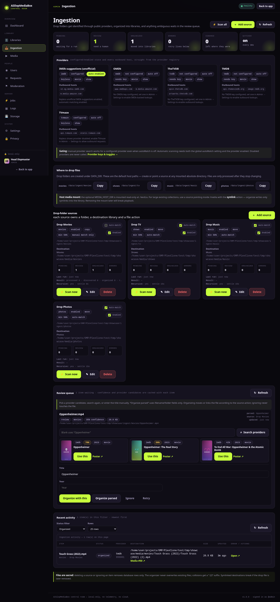

# Ingestion: drop folders, providers, review queue

Ingestion is the "put a file in a folder and stop thinking" path. A watched drop folder is discovered,
parsed from filenames/NFO/sidecars, optionally identified through a metadata provider, then **moved,
copied, hardlinked, or symlinked** into a destination library with a canonical name. Anything ambiguous
waits in a review queue instead of being named something cursed.

The ingestion API is manager/admin-only; the console page lives at **Admin → Ingestion** (`/admin#ingest`)
and requires the admin role.




> Screenshots were captured from a source-run showcase instance, so paths show its temp `DATA_DIR`.
> In Docker the default drop folders are the container paths `/data/ingest/...` shown above. The keyless
> IMDb toggle was enabled only for the capture so the review card has real provider candidates, and the
> demo source uses `copy` to keep its fixtures in the inbox.


## The pipeline

1. **Discover** — walk enabled source folders, skip files that are still changing, and store one queue
   row per `(source, path)`.
2. **Identify** — local first: NFO, filename, folder, embedded tags. Movie/show sources may then ask
   configured providers.
3. **Decide** — confidence at or above the source threshold is organized immediately. Below it, the item
   goes to **review** when "Hold unmatched in review" is on; otherwise it is organized with parsed names.
4. **Organize** — write the canonical path inside the destination library, carry sidecars, never overwrite.
5. **Index** — scan the destination library once per batch, attach the new media row to the ingest item,
   and apply provider metadata/art.
6. **Review** — pick a provider candidate, search again, or type a title/year. Then organize, ignore, or
   retry.

Only movies and shows use online providers. Music and photos are organized from local tags/folders and
never call an external service. Once indexed, organized items are ordinary media rows: they appear in
browse/search, `/api/stream/:id/info`, and progress/resume just like scanned files.

## Drop folders

On boot the app creates four folders under `DATA_DIR` (Docker: `/data`):

| Source kind | Container path | Host path with the default compose bind mount |
|---|---|---|
| `movies` | `/data/ingest/movies` | `./data/ingest/movies` |
| `shows` | `/data/ingest/tv` | `./data/ingest/tv` |
| `music` | `/data/ingest/music` | `./data/ingest/music` |
| `photos` | `/data/ingest/photos` | `./data/ingest/photos` |

When the source table is empty, the server also creates four matching sources: **Drop Movies**,
**Drop TV**, **Drop Music**, and **Drop Photos**. Their defaults are `move`, auto-match on, confidence
threshold `0.5`, hold unmatched on, recursive on, settle `15s`, enabled. The bootstrap is idempotent and
does nothing once a source exists — deleting all sources does not re-create them until the next boot
with an empty table.

Arbitrary mounted directories are fine too. A source path must be:

- **absolute** (`/media/Movies`, not `./Movies` or a host path),
- an **existing directory** (create it on the host/mount first),
- readable by the server's `PUID:PGID`,
- writable too when the action is `move` — and the destination library must always be writable,
- not the app data root itself, the SQLite file, or anything inside the cache/temp trees (the
  `/data/ingest` drop folders are allowed),
- not nested inside its destination library, and not containing its destination library (checked in
  both directions, through symlinks).

Source paths are unique. Deleting a source removes its queue rows, never its files.

### `MEDIA_HOST_DIR` and `/media`

`docker-compose.yml` mounts `${MEDIA_HOST_DIR:-./media}` read-only at `/media`:

```yaml
volumes:
  - ./data:/data
  - "${MEDIA_HOST_DIR:-./media}:/media:ro"
```

Set `MEDIA_HOST_DIR` in `.env` to the folder you actually want exposed. Then a source can point at a
container path such as `/media/Movies` or `/media/Downloads/complete`. For large existing collections,
combining a read-only `/media` source with the **symlink** action avoids copying bytes and leaves the
original files untouched. Removing the mount or the source file later breaks playback for symlinked
entries.

Point a source at the exact directory you mean, not a parent tree you happened to mount. A source on a
parent that also contains application data or unrelated libraries creates noise and can make scan
loops easier to hit.

> `/data/ingest/...` lives on the writable `./data` bind mount, so the default drop folders work even
> when your media mount is read-only. A custom source under `/media` works for discovery, but `move`
> cannot delete from a read-only mount. See [File actions](#file-actions).

### What gets discovered

- `movies` and `shows`: video files (`mkv mp4 m4v avi webm mov wmv flv mpg mpeg ts m2ts`).
- `music`: audio (`mp3 flac m4a aac ogg opus wav wma alac aiff aif`).
- `photos`: images (`jpg jpeg png webp gif avif bmp`).
- Dotfiles and partial/incomplete names (`.part`, `.tmp`, `.crdownload`, `.!qB`) are skipped.
- Zero-byte files are skipped.
- A file whose modification time is newer than the source's **settle seconds** is skipped, so an active
  download is not moved mid-write. Default `15`; range `0–3600`.
- Recursive discovery follows subfolders (season folders, album folders). Symlinked files are followed.
  Walk caps: 50,000 entries, 2,000 new/changed items per pass, depth 32.
- Unchanged `pending`/`review` rows are skipped. An unchanged `organized` or `ignored` row is left alone;
  a changed file is re-queued.
- Missing/unreadable folders produce discovery warnings, not crashes. The source still shows "Last run"
  and a result summary.

## Destination and naming

Each source writes into a **destination library**:

1. the library you chose when adding the source (`libraryId`), if it exists and accepts the kind;
2. otherwise the first library of the matching kind (`shows` needs a `shows` library; `movies`, `music`,
   and `photos` accept their own kind or `mixed`);
3. otherwise an auto-created library under `MEDIA_DIR`:
   `ingested-movies`, `ingested-shows`, `ingested-music`, `ingested-photos`, named
   **Ingested Movies/Shows/Music/Photos** with a `daily` scan schedule.

The destination must not overlap the source path in either direction.

Canonical layouts (every path segment is sanitized: separators/control characters removed, leading and
trailing dots/spaces trimmed, length capped at 120 characters; the final path is verified to stay inside
the library root):

| Kind | Layout | Example |
|---|---|---|
| Movies | `<Title> (<Year>)/<Title> (<Year>)<ext>` | `Touch Grass (2022)/Touch Grass (2022).mp4` |
| Shows | `<Show>/Season NN/<Show> - SxxEyy - <Episode Title><ext>` | `The Slopening/Season 01/The Slopening - S01E02 - The Algorithm Sent Me Here.mkv` |
| Music | `<Artist>/<Album>/<NN - Title><ext>` | `DJ Neural Net/GPU Fan Goes Brrr/01 - GPU Fan Goes Brrr.flac` |
| Photos | `<YYYY>/<original name>` | `2026/01 - grandma said based.jpg` |

Details:

- Movie year is omitted when unknown (`Title/Title.mkv`).
- Show season defaults to `1`, episode to `0`; episode title comes from an episode NFO, the filename,
  or `Episode N`.
- Music falls back to `Unknown Artist` / `Unknown Album`; the track-number prefix appears only when a
  number was parsed.
- Photo year comes from a year in the filename, then the row year, then the file's modification year.
  The original filename is kept.
- Existing destinations are **never overwritten**. A collision gets ` (2)`, then ` (3)`, and so on
  before the extension.
- Slashes, `..`, control characters, and NUL bytes in titles cannot escape the library root.

### Sidecars

Sidecars move with the primary file using the same action:

- same-stem subtitles (`<stem>.en.srt`, `<stem>.en.forced.srt`, `<stem>.en.sdh.srt`, and `.vtt/.ass/.ssa`);
- same-stem NFO, generic `movie.nfo`, show-level `tvshow.nfo`/`show.nfo`, `album.nfo`, `artist.nfo`;
- art named `poster`, `folder`, `cover`, `fanart`, `backdrop`, `background`, `thumb`, `banner`, `logo`,
  `disc`, or `discart` with `jpg/jpeg/png/webp/avif` extensions. Show-level art is copied to the show
  root, movie/album art to the item folder.

Shared sidecars (show/album/artist NFO and art) are written once and not overwritten. If the chosen
canonical title/year contradicts the movie/show NFO, the NFO is deliberately not carried over — a stale
NFO would otherwise win on the next scan and undo your match.

## File actions

| Action | How it writes | Best for | Trade-off |
|---|---|---|---|
| `move` (default) | rename into the library; falls back to copy + unlink across filesystems | normal inbox → library flow | the drop file disappears; a read-only source mount fails, and a later retry sees "Source file disappeared" |
| `copy` | copies bytes, leaves the drop file | keeping the inbox as a backup | uses a second full copy of every file |
| `hardlink` | `link(2)`; falls back to a copy with a note when linking fails (cross-device, permissions) | same-filesystem library where you want no extra space | source and destination must share a filesystem; edits are visible through both paths, and deleting one link leaves the other intact |
| `symlink` | absolute symlink pointing at the drop file | huge read-only mounts you do not want duplicated | **deleting the source file later breaks playback**; the scan follows the link and the row points at the library path |

The symlink target is always the absolute source path. The destination symlink itself lives inside the
destination library. Hardlink fallback and cross-device move fallback are recorded in the item's
`notes` field. The organizer never deletes the source on `copy`, `hardlink`, or `symlink`; deleting a
source configuration or an ingest item only removes database rows.

Read-only sources:

- `move` will fail with an error on the item; switch the source to `copy`, `hardlink`, or `symlink`.
- `copy`/`symlink` only need write access to the destination.
- `hardlink` may fall back to `copy`; read the item notes.

## Confidence and the review queue

Confidence is a `0..1` score stored on the item. Local baselines:

| Situation | Baseline |
|---|---|
| Movie with a usable NFO | `0.95` |
| Movie title + year parsed | `0.55` |
| Movie title only | `0.35` |
| Show title + season + episode parsed | `0.50` |
| Show title only | `0.35` |
| Music / photo | `0.60` |

With auto-match on, eligible providers are searched (movies/shows only). A best candidate at score
`>= 0.55` is resolved and can raise confidence to the candidate/resolved score. The final confidence is
the maximum of the local baseline and provider scores.

A source has a **minimum confidence** (default `0.5`, range `0–1`) and a **hold unmatched** toggle. If
`confidence < minConfidence` and hold is on, the item goes to `review` and stays in place. With hold off,
it organizes using the parsed names. Music/photos start at `0.6`, so the default threshold organizes
them locally.

Queue statuses: `pending` (waiting), `review` (needs a human), `organized`, `error`, `ignored`. An
organized item is settled: match/organize/ignore/retry return `409`. Retry is for pending, review,
error, or ignored items; it resets the row to pending, clears destination/media, and processes again.

### Resolving an item

From **Admin → Ingestion → Review queue**, or the API:

- **Search providers** — query a configured provider manually. Manual search ignores the global
  `autoMatch` switch but still requires the provider to be configured/enabled. Candidates are cached on
  the item with poster/title/year/score.
- **Use this** on a candidate — resolves that provider id, applies its canonical title/year/metadata,
  and organizes immediately (including remote art when the provider host is allowlisted).
- **Manual title/year** — `{ title, year }`; no network call. Shows also accept season/episode and the
  UI carries parsed values. The enrichment is marked local (`provider: null`).
- **Organize parsed** — uses the stored parsed title/year/episode without provider metadata.
- **Ignore** — marks the item ignored; the file is untouched and the queue stops showing it.
- **Retry** — re-runs identification with current settings/providers. Useful after adding a key.

For shows, provider candidates are matched to the show; the destination keeps the parsed episode
number. Subtitle/NFO sidecars follow the same rules as automatic organization.

## Providers

Providers are optional. Nothing is contacted until a provider is **configured** (key present) or a
**keyless toggle** is explicitly enabled. Automatic matching additionally requires **both** the global
**Settings → Automatic provider matching** (`autoMatch`, default on) and the per-source auto-match
toggle. Manual search does not require `autoMatch`.

| Provider | Auth | Settings key / env | Kinds | Outbound hosts |
|---|---|---|---|---|
| TMDB | API key | `tmdbApiKey` / `TMDB_API_KEY` | movie, show | `api.themoviedb.org`, `image.tmdb.org` |
| TheTVDB | v4 API key | `tvdbApiKey` / `TVDB_API_KEY` | movie, show | `api4.thetvdb.com`, `artworks.thetvdb.com` |
| OMDb | API key | `omdbApiKey` / `OMDB_API_KEY` | movie, show | `www.omdbapi.com`, `m.media-amazon.com` |
| TVmaze | keyless, opt-in | `tvmazeEnabled` (default `false`) | show | `api.tvmaze.com`, `static.tvmaze.com` |
| IMDb suggestions | keyless, unofficial, opt-in | `imdbEnabled` (default `false`) | movie, show | `v2.sg.media-imdb.com`, `m.media-amazon.com` |

Provider behavior:

- TMDB key: Settings or environment (`TMDB_API_KEY`, existing metadata client).
- TVDB v4 key: Settings or `TVDB_API_KEY`; the server logs in to `api4.thetvdb.com` and caches the token
  in memory. No key is logged. The provided compose file forwards this variable from `.env`.
- OMDb key: Settings or `OMDB_API_KEY`. OMDb supplies IMDb-backed movie/show details; posters can come
  from `m.media-amazon.com`. Compose forwards this variable from `.env` too.
- TVmaze is keyless and shows-only, but off unless `tvmazeEnabled` is on.
- IMDb suggestions is a **keyless, unofficial community endpoint** (`v2.sg.media-imdb.com`). It is off
  unless `imdbEnabled` is on, can change without notice, and returns suggestion data rather than a
  documented API contract.
- Every request has an 8-second timeout. Failures are logged locally and treated as "no candidates";
  they never fail an ingest run.
- Provider status (`GET /api/ingest/providers`) and the Ingestion page show configured/enabled state,
  keyless/keyed, kinds, and every possible host — never the key itself.
- The global `autoMatch` switch and the per-source toggle gate **automatic** use during scans. Manual
  provider search is an explicit admin action and only needs the provider configured/enabled.
- Art is downloaded only from an allowlisted provider image host. Third-party images are blocked by the
  CSP, so review candidate cards fall back to local placeholder art.
- Hosts and the live opt-in state are also reported by **Admin → Privacy** and
  `GET /api/admin/privacy`; see [Privacy](PRIVACY.md#metadata-providers-and-hosts).

Configure keys/toggles in **Admin → Settings → Metadata providers & privacy**. The Ingestion page shows
the live registry (configured, auto-enabled, hosts) but not the keys.

## Admin workflow

1. **Optional: enable providers.** Admin → Settings. Add a TMDB/TVDB/OMDb key, or turn on TVmaze/IMDb for
   keyless lookups. Leave everything off for a fully local setup.
2. **Add a source.** Admin → Ingestion → **Add source**: name, kind, absolute source folder, optional
   destination library, action, confidence threshold, settle seconds, auto-match/hold/recursive/enabled.
   The four default drop folders are already there on a fresh instance.
3. **Drop files** into the source folder on the host. For the defaults, that is `./data/ingest/movies`,
   `./data/ingest/tv`, etc. Wait for files to finish writing (settle seconds).
4. **Scan now** on one source, or **Scan all**. This queues one `ingest` job. A second request while a
   job is queued/running returns `409 ingest_in_progress` with the active `jobId`.
5. **Watch progress.** The page updates over SSE (`ingest.progress`, `ingest.item`); the Jobs page shows
   the job. Finished counts appear on each source card.
6. **Resolve review items** as described above: use a candidate, search, or enter title/year.
7. **Verify** in Admin → Media/Browse. Organized files are scanned into the destination library and
   linked to media rows automatically.

The background **watcher** can do steps 4–5 for you. It is configured in Settings:

- **Watch drop folders** (`ingestWatch`, default on): each interval, inspect enabled sources; queue a job
  only when discovery finds new/changed work or pending rows. An empty tick creates no job.
- **Watcher interval** (`ingestIntervalSeconds`, default `30`, range `5–3600`).

The watcher reads these settings fresh each tick; saving applies without a restart. It does not bypass
settle delays, thresholds, or review settings.

## Error cases and guardrails

| Symptom | Cause / fix |
|---|---|
| File not discovered | Wrong source path/kind, extension unsupported, still inside settle window, dotfile/partial name, recursive off and file in a subfolder, or unreadable by `PUID:PGID` |
| `Source path must be absolute` / `does not exist` / `is not a directory` | Create the directory on the host/mount and use the container path |
| `Source path cannot live inside the cache/temp directory` or `cannot be the app data root` | Choose a real media/drop folder, not app internals |
| `Source and destination library must not contain each other` | Move the drop folder outside the library root (or vice versa) |
| `That source path is already source #N` | Edit the existing source instead of adding a duplicate path |
| Item `error`: `Source file disappeared` | The file was moved/renamed outside the queue; retry cannot find it. Ignore the row or restore the file |
| Read-only source with `move` | Switch the source action to `copy`, `hardlink`, or `symlink` |
| Permission denied / `EACCES` | Match `PUID:PGID` to the owner and grant read (plus write for move) on source, and write on destination |
| Scan deferred / note `Indexing deferred: scan N is running` | A library scan was already active; the item is still organized and will be picked up by the existing scan/scheduler |
| Destination collision | Existing file was not overwritten; the item got ` (2)` |
| Symlink plays until the drop file is deleted | Expected; symlinks are not copies. Restore the source or re-ingest with `copy` |
| Review queue never drains on a source with hold off | Items organize even below the threshold, so review stays empty by design |
| `ingest_in_progress` (409) | One ingest job at a time; wait for the reported `jobId` or cancel it in Jobs |

Ingestion does not modify production app code or invent metadata: a manual title/year is exactly what
gets written. Provider results are cached with the item so the review page does not re-query on every
render.

## API quickstart

```bash
# login first
curl -c /tmp/slop.cookies -H 'content-type: application/json' \
  -d '{"username":"admin","password":"slop123"}' \
  http://localhost:3100/api/auth/login

# provider registry
curl -b /tmp/slop.cookies http://localhost:3100/api/ingest/providers

# add a source (the path must already exist; run this from the compose project folder.
# With the default bind mount, ./data/ingest/downloads appears at /data/ingest/downloads)
mkdir -p data/ingest/downloads
curl -b /tmp/slop.cookies -X POST -H 'content-type: application/json' -d '{
  "name":"Downloads",
  "kind":"movies",
  "path":"/data/ingest/downloads",
  "action":"copy",
  "autoMatch":true,
  "minConfidence":0.5,
  "holdUnmatched":true
}' http://localhost:3100/api/ingest/sources

# queue discovery + processing for every enabled source
curl -b /tmp/slop.cookies -X POST http://localhost:3100/api/ingest/scan-all

# review queue
curl -b /tmp/slop.cookies 'http://localhost:3100/api/ingest/items?status=review'

# pick a review item id from the list above, then search providers manually.
# The provider must be configured/enabled first; without keys use the manual match below.
ITEM_ID=7   # replace with the id from /api/ingest/items?status=review
curl -b /tmp/slop.cookies -X POST -H 'content-type: application/json' \
  -d '{"query":"Touch Grass"}' \
  "http://localhost:3100/api/ingest/items/$ITEM_ID/search"
curl -b /tmp/slop.cookies -X POST -H 'content-type: application/json' \
  -d '{"provider":"tmdb","providerId":"123456"}' \
  "http://localhost:3100/api/ingest/items/$ITEM_ID/match"

# pure manual match (no network)
curl -b /tmp/slop.cookies -X POST -H 'content-type: application/json' \
  -d '{"title":"Touch Grass","year":2022}' \
  "http://localhost:3100/api/ingest/items/$ITEM_ID/match"
```

All endpoints, fields, status codes, and SSE events are in [API](API.md#ingestion). Operational concerns
(mounts, permissions, provider privacy) are in [Deploy](DEPLOY.md#media-mounts-and-ingestion) and
[Privacy](PRIVACY.md#metadata-providers-and-hosts).
